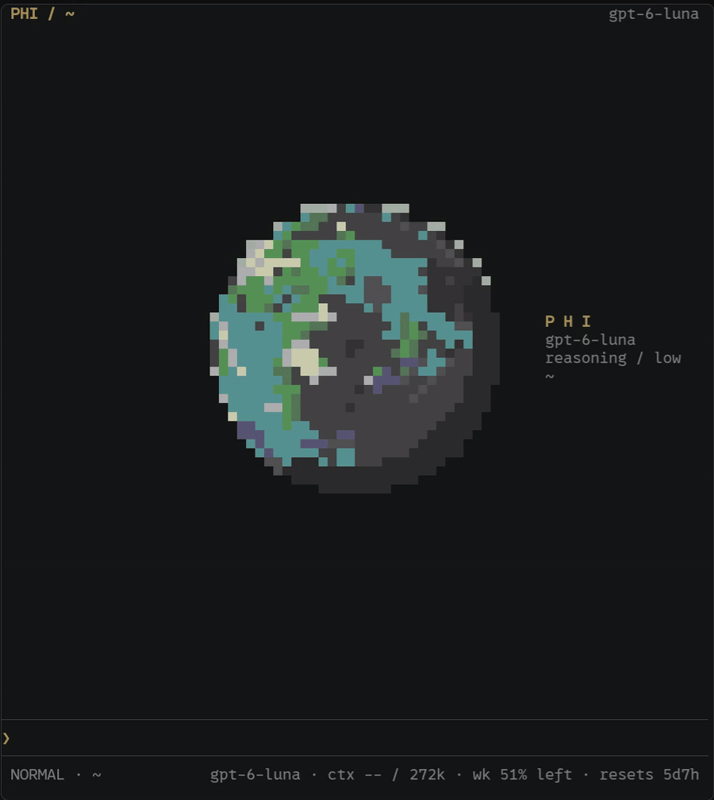
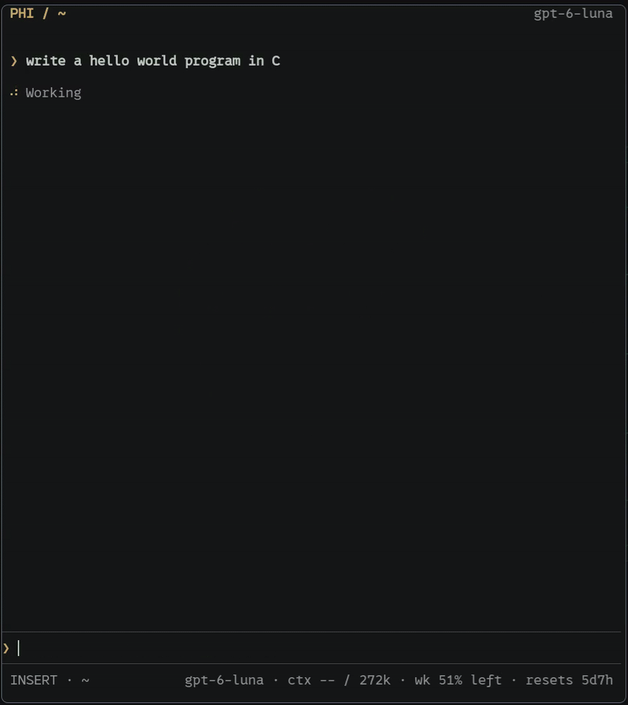
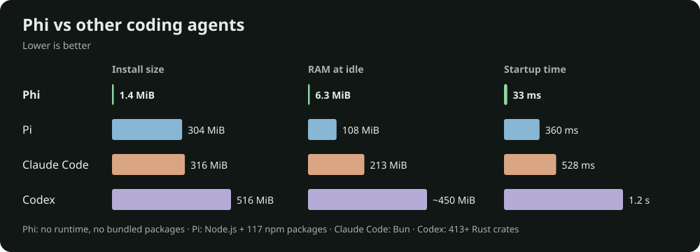

> The name “phi” for an AI coding harness is overloaded, and I apologise for making it worse. Here are some other wonderful projects that share the name:
>
> - [phi-agent](https://github.com/hibuka-labs/phi-agent) — a Rust AI agent framework.
> - [phi](https://github.com/gnassro/phi) — a Pi-based agent for VS Code.
> - [phi](https://github.com/pulseaiclub/phi) — a beautiful, lean coding agent built in Go.
>
> This Phi is heavily inspired by [Pi](https://github.com/earendil-works/pi), a minimal coding agent created by Mario Zechner. I’ve tried to emulate Pi’s minimalism and malleability. With Phi, I wanted to take that philosophy down to the stack itself.

---

# Phi

Phi is a terminal coding agent written in C.

<p align="center">
  
</p>

## Build and installation

Phi is only available for Linux. As I alluded to earlier, Phi is very minimal. To build it, you need:

- A C11 compiler (GCC or Clang, available as `cc`).
- Bash and standard Unix utilities, including `awk`, `od`, and `mktemp`.
- `pkg-config`.
- ncurses tools, including `tic`.
- Development headers and libraries for **libcurl**, **json-c**, **ncursesw**, and **OpenSSL**.

You’ll also need Git to clone the repository and use Phi’s Git and patch tools.

On **Ubuntu / Debian**:

```bash
sudo apt install build-essential pkg-config libcurl4-openssl-dev \
  libjson-c-dev libncurses-dev libssl-dev ncurses-bin git
```

On **Arch Linux**:

```bash
sudo pacman -S --needed base-devel curl json-c ncurses openssl git
```

Then clone, build, and run:

```bash
git clone https://github.com/cmcdo/phi.git
cd phi
./build.sh
./phi
```

Run `./phi --login`, or use `/login` inside Phi, to sign in with your ChatGPT account. Phi currently bundles support for OpenAI’s Codex backend; other providers can be added through extensions.


### Sandboxing

Sandboxing is off by default. To enable it, you’ll need **bubblewrap** (`bwrap`), available as the `bubblewrap` package on Ubuntu/Debian and Arch Linux. For more information, ask an agent running inside Phi.

## Usage

Phi is completely keyboard-centric: Vim mode is the only mode. Press `i` to enter **INSERT** mode and `Esc` to return to **NORMAL** mode. Press `Esc` twice in NORMAL mode to cancel a response midstream.

Type `/help` for a popup with keybindings and command help.

Press the Left arrow twice in NORMAL mode on an empty prompt to background an agent. Run `phi board`, or type `/board` inside Phi, to open the board and move between Working, Waiting, and Saved chats.

For more command-line modes and options, run `phi --help`.
## Customisation

Phi is very customisable—ask your agent to make it your own. These bundled themes give a taste of what’s possible:



Use `/theme` to list themes, or `/theme default` to return to the planet. Your agent can explain how themes work, create a new one, or go further with native C extensions.

- [Themes](docs/themes.md) — colours, layout, and appearance.
- [Extensions](docs/extensions.md) — tools, commands, hooks, providers, and native UI behaviour.

## Extensibility

Native C extensions can add tools, slash commands, model providers, agent behaviour, and UI components—without rebuilding Phi itself. They can also integrate external services, including MCP servers.

Extensions can also add widgets: styled text above or below the prompt, or animated, interactive cell-based displays in the header and welcome area. The bundled planet and Game of Life demonstrate the native widget interface, which supports animation timers, pointer input, and controls. You could use it for a live status display, a visualisation, or a small interactive tool.

Ask your agent to build what you need. Phi includes its extension SDK and authoring guide, and can compile and reload extensions once you approve them.

Extensions run inside Phi and are not sandboxed. Only approve code you trust.

See the [extension guide](docs/extensions.md) for details.

## Memory and Performance



## License

[MIT](LICENSE)

