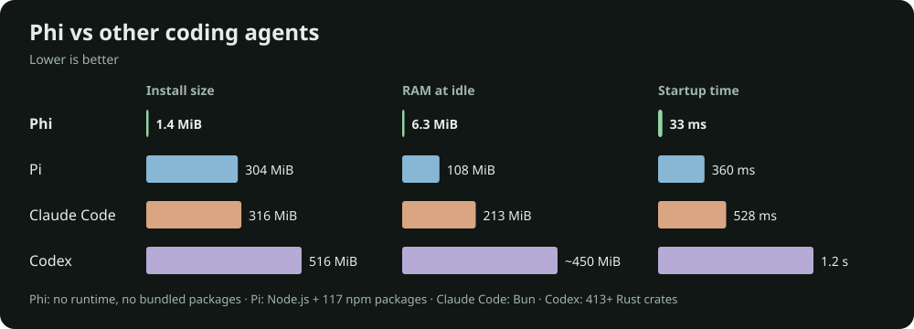

# Startup memory benchmark

## Results

Total proportional set size (PSS), in MiB. Each trial value is the median of five samples; the table reports the median and range across three launches.

| Application | Version | Median MiB | Trial min–max MiB |
| --- | --- | ---: | ---: |
| Phi | 0.1.0 | 6.58 | 6.49–6.61 |
| Pi | 1.5.0 | 109.75 | 109.04–110.27 |
| Claude Code | 2.1.317 | 242.31 | 241.36–243.98 |
| Codex | 0.166.0 | 1096.43 | 1037.90–1098.52 |

## Method

- Arch Linux, Linux 7.2.11-arch1-1, Intel Core i5-8365U; approximately 7.4 GiB system RAM. Other desktop workloads were not stopped.
- Real 100-column × 30-row pseudo-terminals; separate empty temporary working directories.
- Normal HOME, configuration and authenticated profiles were used. Model/account configuration was retained; no prompts were submitted. Environment-based API keys were not passed.
- Application session identifiers inherited from the coordinating agent were removed. Each trial had a private runtime directory and a unique environment marker.
- One application at a time; three launches each, rotating launch order. No filesystem cache dropping.
- Wait eight seconds after spawning, then take five samples spaced approximately 0.3 seconds apart. This is a fixed post-launch window, not a measurement of peak memory or a claim of long-term equilibrium.
- Sum `/proc/PID/smaps_rollup` PSS for processes retaining the unique trial marker, including detached hosts. PSS apportions shared resident pages instead of fully counting them once for every process. RSS and private memory are also retained in the raw data.
- Phi includes its attaching client, host, and chat process. Codex includes its client, managed app-server, and daemon pid-update-loop process. Pi and Claude each had one retained process in these samples.
- Captured terminal output was inspected: all four reached their interactive editors, not login or onboarding screens. Terminal captures are not included publicly because they can contain profile information.
- Cleanup terminated only processes carrying the trial marker. No pre-existing user agent processes were stopped.

## Limitations

These are local normal-profile measurements, not a fully normalized feature comparison. Existing settings, background work, library sharing and cache state affect the results. Phi displayed its built-in animated welcome; the other programs used their normal configured appearances. Model selections differed, but no model tasks ran.

Pre-existing shared services without the trial marker are outside this accounting. Terminal-emulator memory and kernel memory are excluded. Process lists and per-sample totals are provided for inspection. Treat the relatively large Codex value as this version/configuration’s measured startup footprint, not a claim about every Codex release or steady-state workload.

The failed preliminary runs (empty profiles and an inherited Phi session identifier) were discarded; none of their numbers appear here.

## Data

- [Environment and protocol](benchmarks/memory/environment.json)
- [Per-process samples](benchmarks/memory/trials.json)
- [Summary](benchmarks/memory/summary.json)

The exact local Python harness and private ANSI captures are retained with the original results outside the public tree. No launch-time comparison was performed.

## Codex follow-up investigation

The large result should not be generalized to all Codex installations. This host's
transparent-huge-page policy was checked after the benchmark and is `always`.
The installed Codex binaries are the Linux musl build.

Upstream [issue #54845](https://github.com/openai/codex/issues/54845) reports high
anonymous app-server memory with jemalloc arenas and THP on Linux musl 0.163.0.
It includes a reproduction and process-local controls; it is an open user report,
not a confirmed explanation of our 0.166.0 measurements.
[PR #42850](https://github.com/openai/codex/pull/42850), merged September 4, 2026,
confirms the Linux musl CLI and app-server switched to jemalloc.

An additional normal-profile client run used approximately 600.84 MiB PSS at
eight seconds and 600.37 MiB at both thirty and sixty seconds. This run reused
an existing shared daemon: **those client-only figures must not replace the
full-process totals in the main comparison**. The existing server and update
loop were separately observed at approximately 373 and 138 MiB PSS. Those
service readings were not simultaneous with the client samples.

Single diagnostic client launches measured approximately 390.67 MiB with
`_RJEM_MALLOC_CONF=narenas:2`, and 539.61 MiB with process-local THP disabled.
The shared daemon was not reconfigured. These are unrepeated diagnostics, not
an optimized full-stack benchmark or proof that one allocator setting explains
the whole difference. No global kernel settings or persistent application
settings were changed. The original chart remains the unmodified launch results.
